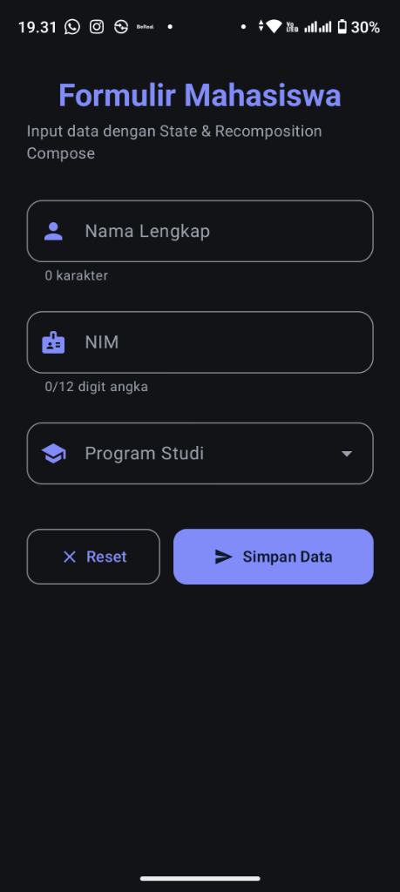
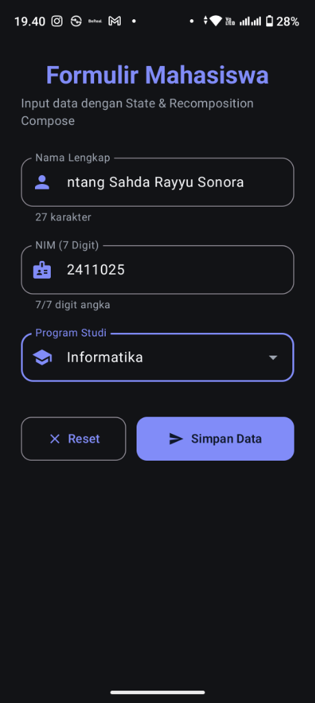
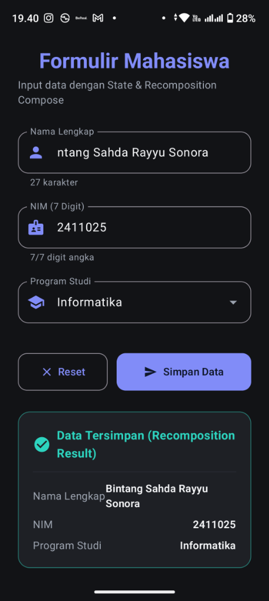
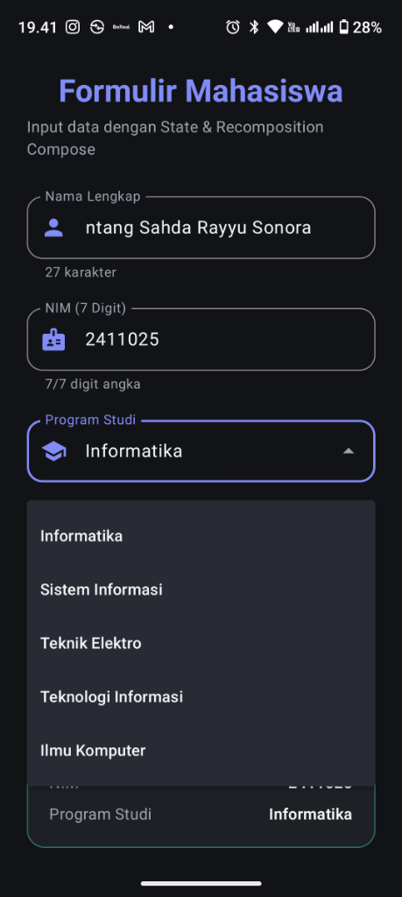

# Aplikasi Formulir Mahasiswa (Jetpack Compose) 🎓

Aplikasi Android modern berbasis **Jetpack Compose** untuk menginput data Mahasiswa (**Nama**, **NIM**, dan **Program Studi**). Didesain dengan **Tema Gelap (Dark Theme)** Material 3, menerapkan manajemen **State**, **Event**, **Validasi Input**, **Snackbar**, dan pembuktian **Recomposition**.

---

## 📸 Tangkapan Layar (Screenshots)

| 1. Form Awal | 2. Input Data & Validasi | 3. Hasil Recomposition | 4. Dropdown Program Studi |
| :---: | :---: | :---: | :---: |
|  |  |  |  |

---

## ✨ Fitur Utama

1. **State Management (`remember` & `mutableStateOf`):**
   * Mengelola state input Nama, NIM, Program Studi, pesan error validasi, dan data tersimpan.
2. **Event Handling (`onValueChange` & `onClick`):**
   * Menerapkan pola *Unidirectional Data Flow (UDF)*.
   * `onValueChange` untuk input Nama dan pembatasan real-time 7 digit angka untuk NIM.
   * `onClick` pada tombol **Simpan Data** dan **Reset**.
3. **Validasi Input:**
   * **Nama:** Wajib diisi (minimal 3 karakter).
   * **NIM:** Wajib tepat 7 digit angka (contoh: `2411025`).
   * **Program Studi:** Wajib dipilih dari dropdown menu (`Informatika`, `Sistem Informasi`, `Teknik Elektro`, `Teknologi Informasi`, `Ilmu Komputer`).
4. **Snackbar:**
   * Menampilkan umpan balik visual saat data berhasil disimpan, validasi gagal, atau form direset menggunakan `SnackbarHostState` dan `rememberCoroutineScope()`.
5. **Recomposition:**
   * Kartu *"Data Tersimpan"* secara reaktif me-render ulang UI segera setelah state `submittedMahasiswa` diperbarui melalui tombol Simpan.
6. **Tema Gelap (Material 3 Dark Theme):**
   * Palet kontras modern: Surface `#1E2025`, Background `#121316`, Primary Indigo `#818CF8`, Secondary Teal `#2DD4BF`.

---

## 🛠️ Spesifikasi & Teknologi

* **Bahasa:** Kotlin 2.0.21
* **UI Toolkit:** Jetpack Compose (BOM 2024.10.01, Material 3 1.3.1)
* **Compile SDK / Target SDK:** 35 / 34
* **Min SDK:** 24 (Android 7.0+)
* **Build System:** Gradle 8.9 (AGP 8.7.3)

---

## 🚀 Cara Menjalankan

1. Clone repositori ini:
   ```bash
   git clone https://github.com/araalodie/FormMahasiswaCompose.git
   ```
2. Buka folder proyek di **Android Studio** (Hedgehog / Iguana / Jellyfish / Ladybug atau versi terbaru).
3. Biarkan Gradle melakukan sinkronisasi (*Sync Project with Gradle Files*).
4. Hubungkan perangkat Android fisik atau jalankan Android Emulator.
5. Tekan tombol **Run (Shift + F10)**.

---

## 📝 Refleksi Pembelajaran

Pengembangan aplikasi formulir mahasiswa ini memberikan pemahaman mendalam mengenai paradigma pemrograman deklaratif modern pada Android menggunakan **Jetpack Compose**:

1. **Pergeseran Paradigma (Deklaratif vs Imperatif):**
   * Berbeda dengan pendekatan View tradisional berbasis XML yang mengandalkan manipulasi manual (`findViewById`, setter), Jetpack Compose memperlakukan antarmuka sebagai fungsi murni dari State (`UI = f(State)`). Hal ini mengurangi *boilerplate code* dan mencegah inkonsistensi status UI.
2. **Manajemen State & Recomposition:**
   * Kombinasi `remember` dan `mutableStateOf` menjadi kunci utama dalam mempertahankan nilai melintasi proses *recomposition*.
   * Terbukti bahwa Jetpack Compose bekerja secara cerdas (*smart recomposition*), hanya me-render ulang komponen yang membaca state yang berubah (seperti counter karakter dan kartu hasil data tersimpan).
   * Menerapkan pola *Unidirectional Data Flow* (UDF)—di mana Event mengalir ke atas (`onValueChange`, `onClick`) dan State mengalir ke bawah—membuat alur logika aplikasi terstruktur dan mudah di-debug.
3. **Validasi Input & Pengalaman Pengguna (UX):**
   * Pembatasan input real-time pada NIM (tepat 7 digit angka) serta validasi Nama dan Program Studi memastikan integritas data sebelum diproses.
   * Pemanfaatan `rememberCoroutineScope()` untuk mengeksekusi `Snackbar` melatih penanganan *asynchronous suspend function* di dalam Composable tanpa memblokir thread antarmuka (*UI thread*).
4. **Desain Modern dengan Material 3 Dark Theme:**
   * Penerapan `darkColorScheme` menunjukkan fleksibilitas Compose dalam membangun antarmuka bertema gelap modern yang kontras, elegan, dan nyaman di mata.

